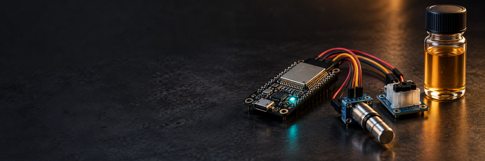
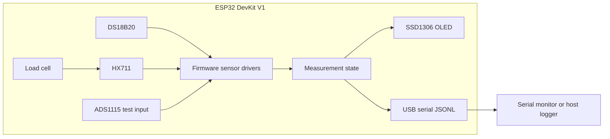

# EthanolBlend



> Low-cost ESP32 instrumentation for controlled petrol–ethanol blend experiments.


EthanolBlend is an embedded prototype for exploring whether electrical response, sample mass/density, and temperature can support a calibrated estimate of ethanol fraction in petrol–ethanol reference blends. The repository currently contains **Phase 1 hardware bring-up firmware**. It reads the temperature sensor, load cell amplifier and a safe ADS1115 test channel, reports sensor status on an OLED, and publishes JSON Lines over USB serial.

> **Current scope:** this firmware does not analyze fuel or estimate ethanol percentage. Density and electrical response are unavailable, the load cell scale is a placeholder until calibrated, and excitation metadata is not measured. Treat readings as development instrumentation, not fuel-quality results.

## Project status

| Capability | Status | Notes |
|---|---|---|
| ESP32 boot and serial command interface | Implemented | 115200 baud; JSON measurement lines start with `{`, diagnostics with `#` |
| DS18B20 temperature | Implemented | Validity tracked separately from the value |
| HX711 load-cell acquisition | Implemented, uncalibrated | Set the scale factor using a known mass before interpreting grams |
| ADS1115 acquisition | Bring-up test | Reads configured test channel; not an electrode measurement |
| OLED status and measurements | Implemented | 128×64 SSD1306 over I²C |
| Volume, density and fuel electrical response | Not implemented | Published as unavailable; no ethanol estimate is produced |

## System overview



## Hardware and wiring

The pin map is centralized in [`src/config.h`](ethanol-blend-analyzer/src/config.h) for the assumed generic ESP32 DOIT DevKit V1.

| Module | ESP32 connection | Notes |
|---|---|---|
| OLED SSD1306 + ADS1115 | SDA GPIO 21, SCL GPIO 22 | Shared I²C bus; OLED address `0x3C`, ADS1115 `0x48` |
| DS18B20 | DQ GPIO 4 | Add an external 4.7 kΩ pull-up to 3.3 V |
| HX711 | DOUT GPIO 16, SCK GPIO 17 | Verify wiring and calibrate with a known mass |
| ADS1115 | A0 is test input | Power module from 3.3 V; keep analog inputs within safe supply limits |

Review the board and module datasheets before wiring. Do not connect a 5 V analog signal to a 3.3 V powered ADS1115/ESP32 setup.

## Build and upload

1. Install [VS Code](https://code.visualstudio.com/) and the PlatformIO IDE extension.
2. Open this repository (the PlatformIO project is in `ethanol-blend-analyzer/`).
3. Connect a compatible ESP32 DevKit V1.
4. Build, upload, then open the PlatformIO serial monitor at **115200 baud**.

CLI alternative, from the firmware directory:

```bash
cd ethanol-blend-analyzer
pio run
pio run --target upload
pio device monitor --baud 115200
```

PlatformIO installs the libraries listed in `platformio.ini` automatically.

## Serial output and commands

The firmware emits periodic JSON Lines measurement records. Values that are not available are `null`; this is intentional and avoids presenting missing measurements as real values. Human-readable status lines are prefixed with `#`.

Available commands include `help`, `status`, `temp`, `hx711_raw`, `weight`, `tare`, `set_scale <factor>`, `adc [channel]`, and `adc_stats [channel] [samples]`. Use `help` on the serial monitor for details. HX711 readings in grams are not meaningful until calibrated.

## Repository layout

```text
ethanol-blend-analyzer/
├── ethanol-blend-analyzer/       # PlatformIO firmware project
│   ├── platformio.ini
│   └── src/
│       ├── communication/        # Serial commands and JSONL output
│       ├── display/              # SSD1306 status and measurements
│       ├── electrical/           # Measurement data model
│       ├── sensors/              # ADC, load cell, temperature drivers
│       ├── config.h              # Pins, timing and calibration settings
│       └── main.cpp              # Setup and sensor/update loop
├── docs/                          # Design and implementation notes
└── README.md
```

## Roadmap

- Complete sensor bring-up and record repeatable calibration procedures.
- Add a defined sample vessel and validated volume measurement before calculating density.
- Characterize and implement the electrical measurement front-end before claiming a fuel response.
- Collect known reference blends and evaluate calibration error on held-out samples.
- Add a host-side analysis and visualization workflow once the measurement schema stabilizes.

## Contributing

Issues and focused pull requests are welcome. Include the board and module versions, wiring changes, PlatformIO output, and a short description of how the behavior was verified. Keep experimental measurements and assumptions labeled.

## License

No license is currently declared. Unless a license is added, reuse and redistribution are not granted by default.
